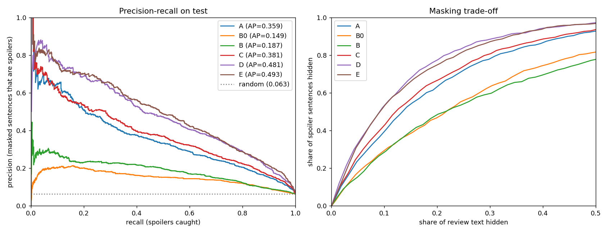

# Results: sentence-level spoiler models

Produced by `notebooks/spoiler_models.ipynb`, run on Google Colab (T4 GPU) on 24 Nov 2026, trained on `data/spoiler_detection_dataset_1.3.1.json`.
Test set: 21 movies never seen in training (15,944 sentences, 6.3% spoilers). Thresholds and hyperparameters were tuned on 12 held-out *train* movies, never on test.

| model | pr_auc | pr_auc_ci | roc_auc | precision | recall | f1 | recall_at_p50 | words_masked | spoiler_reviews_fully_clean | clean_reviews_untouched |
|---|---|---|---|---|---|---|---|---|---|---|
| A  TF-IDF + LR (review only) | 0.359 | [0.313, 0.412] | 0.874 | 0.323 | 0.527 | 0.401 | 0.207 | 0.144 | 0.353 | 0.596 |
| B0 Synopsis similarity threshold | 0.149 | [0.113, 0.198] | 0.751 | 0.154 | 0.464 | 0.231 | 0.0 | 0.198 | 0.22 | 0.35 |
| B  LR on synopsis features | 0.187 | [0.143, 0.241] | 0.777 | 0.195 | 0.504 | 0.282 | 0.0 | 0.217 | 0.258 | 0.404 |
| C  TF-IDF + synopsis features | 0.381 | [0.321, 0.443] | 0.886 | 0.335 | 0.556 | 0.418 | 0.283 | 0.146 | 0.35 | 0.636 |
| D  DistilBERT (review only) | 0.481 | [0.416, 0.551] | 0.914 | 0.362 | 0.69 | 0.474 | 0.424 | 0.154 | 0.46 | 0.6 |
| E  DistilBERT (review + synopsis) | 0.493 | [0.429, 0.563] | 0.919 | 0.341 | 0.729 | 0.465 | 0.486 | 0.187 | 0.504 | 0.521 |

**Key finding.** DistilBERT clearly beats TF-IDF: E vs. C gives +0.112 PR-AUC (paired movie bootstrap, 95% CI +0.061 to +0.167). The synopsis adds only +0.013 PR-AUC to DistilBERT: E vs. D has a 95% CI of -0.027 to +0.053, and E is better on 15 of 21 movies.

* `pr_auc`: average precision; a random model scores 0.063. `pr_auc_ci`: 95% bootstrap interval, resampling movies.
* `recall_at_p50`: share of spoilers caught when at least half of the masked sentences must be real spoilers.
* `words_masked`: share of review text hidden. `spoiler_reviews_fully_clean`: reviews with spoilers where *every* spoiler sentence was hidden.
  `clean_reviews_untouched`: spoiler-free reviews where nothing was hidden.

| File | Content |
|---|---|
| `metrics_test.csv` | the table above |
| `pr_curves.png` | precision–recall curves and the masking trade-off (text hidden vs. spoilers hidden) |
| `predictions_test.csv` | every test sentence with its gold label, each model's score and the best-matching synopsis sentence |
| `per_movie_ap.csv` | PR-AUC per test movie, DistilBERT without (D) vs. with (E) synopsis |
| `errors_*.csv` | analysed failure cases: missed spoilers, false alarms, where the synopsis helps / hurts |
| `stress_tests.csv` | 21 hand-written edge cases (premise vs. ending, disclaimers, paraphrases, wrong synopsis) scored by every model |
| `distilbert_training_history.csv` | loss and validation PR-AUC per epoch for D and E |
| `run_config.json` | thresholds, chosen model, validation movies |
